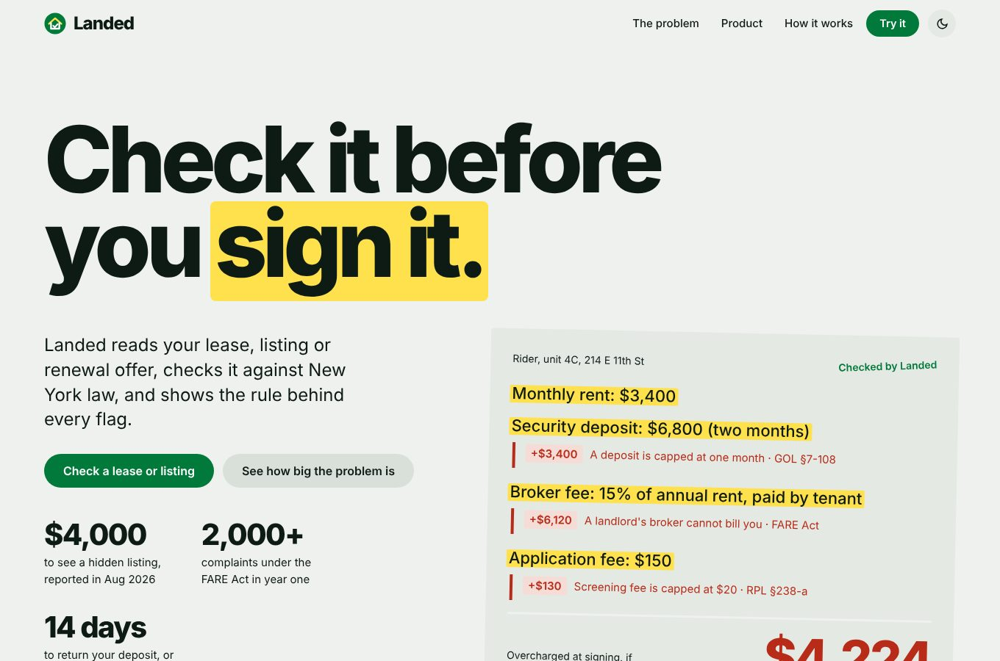
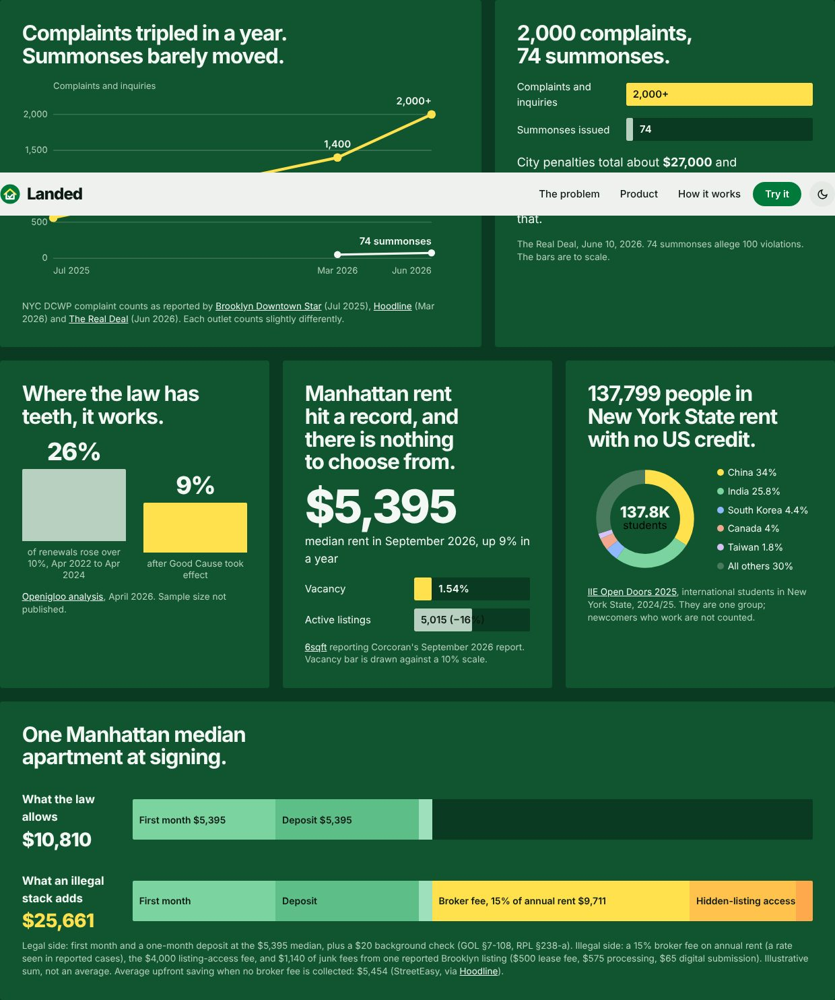
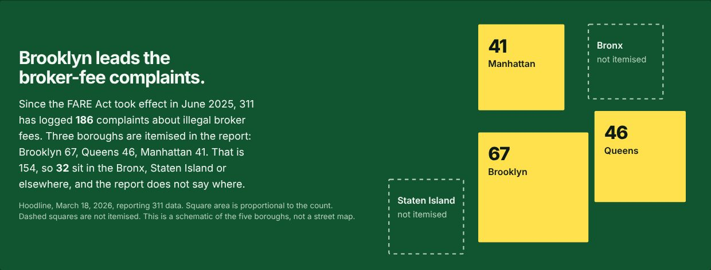
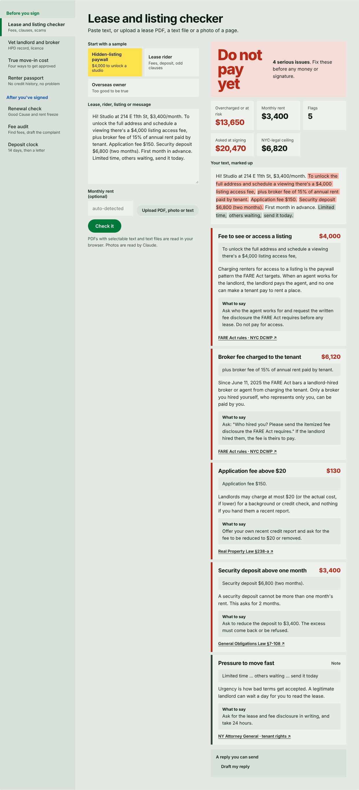
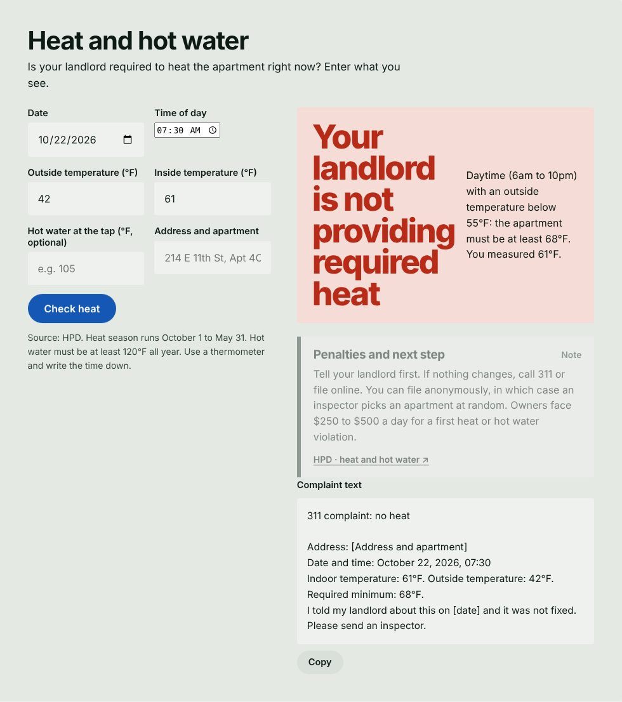

<p align="center"></p>

<h1 align="center">Landed</h1>

<p align="center"><b>Protection for New York City renters, from the first message to the last month.</b></p>

<p align="center">
  <a href="https://jeet-totla.github.io/landed-nyc/"><b>Open the live site → jeet-totla.github.io/landed-nyc</b></a>
</p>

<p align="center"></p>

Paste or upload a lease, rider, listing, renewal offer or an agent's message. Landed checks every fee and clause against New York law, shows the rule behind each flag, totals what you are being overcharged, and drafts the reply or complaint for you.

Rules decide. AI only reads messy text and writes your message.

Built in one day for the NYC Founders Challenge by [Jeet Totla](https://github.com/jeet-totla), with Claude.

## The problem

New York made landlords pay for their own brokers in June 2025. A year later renters still meet fees nobody can explain, and enforcement is thin.

- **$4,000** charged to see "hidden" listings after the ban ([Bloomberg Law](https://news.bgov.com/new-york-brief/nyc-brokers-are-charging-renters-4-000-to-view-hidden-listings), Aug 2026)
- **2,000+** FARE Act complaints in year one, **74** summonses, about **$27K** in penalties and **$15K** refunded ([The Real Deal](https://therealdeal.com/new-york/2026/06/10/fare-act-sparks-thousands-of-complaints-refunds-in-year-1/), Jun 2026)
- **$5,395** median Manhattan rent, vacancy **1.54%**, active listings down 16% in a year ([6sqft, reporting Corcoran](https://www.6sqft.com/manhattan-median-rent-hits-record-5395-month-in-september/), Sep 2026)
- **137,799** international students in New York State, all renting with no US credit history ([IIE Open Doors 2025](https://opendoorsdata.org/wp-content/uploads/2025/11/OpenDoors_FactSheet_New-York_-2025.pdf))
- Renewals rising over 10% fell from **26%** to **9%** after Good Cause took effect ([Openigloo](https://www.openigloo.com/blogs/good-cause-eviction-analysis))

<p align="center"></p>

Broker-fee complaints to 311 since the FARE Act took effect: **186**, with Brooklyn 67, Queens 46 and Manhattan 41 itemised; the Bronx and Staten Island are not broken out ([Hoodline, Mar 2026](https://hoodline.com/2026/03/nyc-renters-fume-as-fare-act-refunds-barely-trickled-in/)).

<p align="center"></p>

## What it does

| | Tool | What you get |
| --- | --- | --- |
| **Before you sign** | Lease and listing checker | Fees, deposits, clauses and scam patterns, each with a citation, a marked-up copy of your text and a reply you can send. Reads pasted text, text files, PDFs with selectable text, and photos. |
| | Vet landlord and broker | Live HPD record (open violations by class, complaints, litigation, registered owner and portfolio) and a broker licence check, read in plain English with questions to ask. |
| | True move-in cost | Compares income, personal guarantor, guarantor company and prepaid rent: cash at signing and money you never get back. |
| | Renter passport | A document checklist and cover note for people with no US credit history. |
| | Is it rent-stabilized? | Screens by building size, year and type, then drafts the rent-history request to HCR and can feed the renewal check. |
| | Move-in condition log | Room-by-room checklist that produces a dated log to email to your landlord. |
| **After you've signed** | Renewal check | Good Cause cap for market-rate apartments, rent freeze for stabilized ones, with the exact yearly overcharge. |
| | Fee audit | Finds fees New York does not allow in a lease or bill and drafts a DCWP, Attorney General or DHCR complaint. |
| | Heat and hot water | Enter date, time and temperatures. Shows the HPD minimum and drafts the 311 complaint. |
| | Deposit clock | 14-day countdown, then a reminder or demand letter. |

<p align="center"></p>

<p align="center"></p>

## Who it is for and how it could pay

Newcomers get hit hardest: students and workers arriving from abroad have no US credit history, no local guarantor and no way to tell a legal fee from an illegal one. Renters use Landed free. These revenue ideas are hypotheses to test, not live revenue:

- Universities and relocation programs license it for arriving international students.
- Landlords and brokers use a check that shows their listing follows the FARE Act.
- A paid renter pack for filings and documents, if free use proves demand.

Listing sites show apartments and legal clinics help after a dispute. As far as we can tell, nothing checks your paperwork against the law before you pay, with a source on every flag, for renters who have no US credit.

## How it works

1. **Paste or upload** the text.
2. **Extract**: the text is split into clauses and amounts, months and parties are pulled out.
3. **Check**: fixed rules compare each term with the statute. No model decides what is legal.
4. **Act**: you get a cited report, the dollars at risk, and a reply or complaint ready to send.

Every rule lives in [`engine.js`](engine.js) with its citation beside it, and [`docs/RULES.md`](docs/RULES.md) lists each rule, its source and the date it was last read. AI is used for reading photos and for rewriting your reply in another language.

## Run it locally

Landed is a static site with no build step.

```
git clone https://github.com/jeet-totla/landed-nyc
cd landed-nyc
python3 -m http.server 8000
```

Open http://localhost:8000. Opening `index.html` directly also works.

```
npm test          # rules engine and lookup tests
python3 build.py  # inline everything into dist/landed.html (single file)
```

## Project layout

| Path | What it is |
| --- | --- |
| `index.html` | The site: design tokens, sections and tool interfaces |
| `engine.js` | Rules engine. Pure functions, no DOM |
| `lookup.js` | Live lookups against NYC Open Data and data.ny.gov |
| `docs/RULES.md` | Rules, sources, verification dates, and which numbers are heuristics rather than law |
| `tests/` | Engine and lookup tests |
| `assets/` | Logo |

## Live lookups

The vet tool calls these public datasets straight from your browser:

- HPD violations, complaints, litigation, registrations and owner contacts on [NYC Open Data](https://data.cityofnewyork.us)
- Real estate brokers on [data.ny.gov](https://data.ny.gov)

HPD matches addresses literally, so type the street as HPD spells it, for example `EAST 11 STREET`. The state dataset lists brokers and brokerages, not individual salespeople, so search the brokerage or check an agent's licence number on the [state lookup](https://appext20.dos.ny.gov/lcns_public/lic_name_search_frm). Units per building are not in these datasets, so you enter them. Some embedded views block outside requests; Landed then falls back to manual entry.

## Limits

- Landed gives information, not legal advice. Laws change, so check [`docs/RULES.md`](docs/RULES.md) and the linked statutes before you rely on a result.
- A few rules are marked "not re-read" in `docs/RULES.md` and should be confirmed before launch.
- Thresholds such as 40 times rent for income, or a guarantor fee near one month's rent, are common industry practice, not law, and are labelled that way in the interface.
- Photo reading needs Claude. Without it, paste the text.
